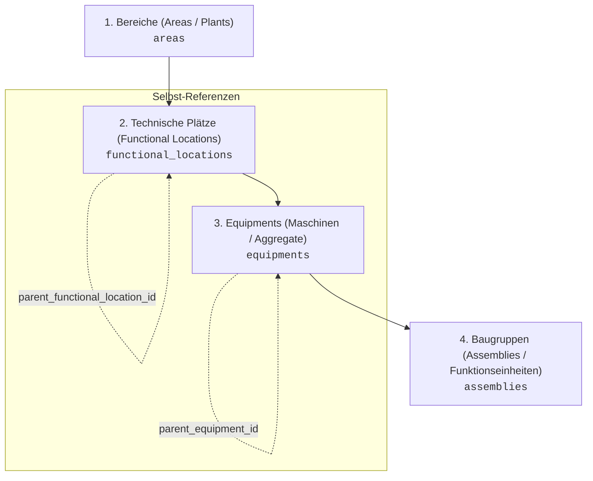

# 🔌 2. SAP-Integration & Anlagenverwaltung: Standalone vs. Enterprise-Sync

Pfad in der Anwendung: `Administration > SAP-Schnittstelle` (`/admin`) und `STAMMDATEN > Anlagen & Equipments` (`/equipments`), `Technische Plätze` (`/functional-locations`), `Ersatzteile & Lager` (`/spare-parts`)

---

## 1. Ziel & Konzept

**MaintAI** fungiert als resiliente Industrie-Middleware und modernes CMMS. Die Plattform kann sowohl vollkommen autark (**Standalone-Modus**) an dezentralen Standorten ohne ERP-Infrastruktur betrieben werden, als auch als nahtlos integriertes Subsystem (**Enterprise-Sync**) zu bestehenden Unternehmenssystemen wie **SAP PM (Plant Maintenance)** und **SAP MM (Materials Management)** auf Basis von SAP S/4HANA oder SAP ECC 6.0.

Das Zusammenspiel zwischen MaintAI und SAP basiert auf klaren Governance-Regeln:
- **Führendes System (Single Source of Truth):** Im aktiven SAP-Modus ist SAP PM die führende Instanz für alle Stammdaten der Anlagenhierarchie.
- **Entkoppelte Resilienz:** Transaktionale Vorgänge (z. B. Materialentnahmen oder Statusrückmeldungen) werden bei Netzwerkausfällen über eine persistente Outbox-Queue (`sap_sync_queue`) gepuffert.

---

## 2. Unterstützte Betriebsmodi

Der Betriebsmodus wird pro Mandant (`tenants.sapSyncMode`) oder über die globale Umgebungsvariable `SAP_MODE` konfiguriert:

| Modus | Typ | Zielsystem | Beschreibung |
|---|---|---|---|
| `STANDALONE` | Autark | Lokale DB (PostgreSQL / SQLite) | Keine Verbindung zu SAP. Vollständige manuelle Pflege aller Stammdaten und lokale Materialwirtschaft direkt in MaintAI. |
| `ODATA_V4` | Enterprise | SAP S/4HANA (Cloud / On-Premise) | Moderne REST/OData v4 Schnittstelle (`ODataSapConnector`) mit CSRF-Token-Handling und Batch-Verarbeitung. |
| `RFC_BAPI` | Enterprise | SAP ECC 6.0 / R/3 | Klassische RFC-Anbindung (`BapiSapConnector`) über SAP NetWeaver RFC SDK zur Ausführung von Standard-BAPIs (z. B. `BAPI_ALM_ORDER_MAINTAIN`). |

Die Umschaltung erfolgt ohne Systemneustart über die Administrationskonsole oder automatisiert bei Mandanteninitialisierung.

---

## 3. Die 4-stufige Anlagenhierarchie

MaintAI bildet die Anlagenstruktur nach **DIN 31051** und **SAP PM** in einer hierarchischen 4-Ebenen-Topologie ab:

1. **Bereiche (`areas` / Stufe 1):**  
   Oberste organisatorische Werkeinheit oder Werkshalle (z. B. `AREA-01: Fertigungshalle 1`, `AREA-02: Montage & Verpackung`).
2. **Technische Plätze (`functional_locations` / Stufe 2):**  
   Orts- und funktionsbezogene Einheiten (z. B. `W1-HALLE1-L1: Fertigungslinie 1`). Unterstützt hierarchische Unterstrukturen über `parentFunctionalLocationId` sowie die SAP-Kennung `sapTplnr` und Kostenstellen (`costCenter`).
3. **Equipments (`equipments` / Stufe 3):**  
   Physische Maschinen, Pumpen, Roboter und Aggregate mit eindeutiger Gerätenummer (`equipmentNumber`), SAP-Equipmentnummer (`sapEquipmentNr`), Kritikalitätsklasse (`A`, `B`, `C`) und Betriebsstundenzähler.
4. **Baugruppen (`assemblies` / Stufe 4):**  
   Feingranulare Komponenten (z. B. Wellendichtung, Getriebestufe, Leistungselektronik), an denen Fehlerursachen und Ersatzteilverbräuche dokumentiert werden.

---

## 4. Governance: Schreibschutz im aktiven SAP-Modus

Um Dateninkonsistenzen zwischen MaintAI und dem ERP-System zu unterbinden, greift bei `sapSyncMode !== 'STANDALONE'` ein striktes Schutzkonzept:

1. **Automatischer Schreibschutz für SAP-Objekte:**
   - Alle aus SAP importierten Bereiche, Plätze, Equipments und Baugruppen tragen das Herkunfts-Flag `source = "SAP"`.
   - Die Bearbeitung von Bezeichnungen, Platzierungs-Hierarchien oder Kostenstellen ist in der UI gesperrt (Schloss-Symbol und Hinweismeldung: *"Führendes System ist SAP PM. Stammdatenänderungen müssen im ERP erfolgen.*").
2. **Manuelle Pflege im Standalone-Modus:**
   - Befindet sich der Mandant im Modus `STANDALONE`, ist die Neuanlage und Pflege von Standorten und Equipments freigeschaltet.
   - Nur Benutzer mit der Rolle **`ADMIN`** (oder der expliziten Berechtigung `assets:manage`) dürfen die Anlagenstruktur verändern (`assertAssetWritePermission`).
   - Servicetechniker (`TECHNICIAN`), Planer (`MAINT_PLANNER`) und Bediener (`OPERATOR`) haben rein lesenden Zugriff auf den Strukturbaum, können jedoch Störmeldungen und Prüfprotokolle zu den Einheiten erfassen.
3. **Automatische Herkunftsmarkierung:**
   - Alle neu angelegten Einheiten erhalten atomar das Flag `source = "MANUAL"` sowie `sapSyncStatus = "NOT_APPLICABLE"`.

---

## 5. Stammdatenabgleich aus SAP PM

Die Synchronisation der Anlagenstruktur aus SAP PM erfolgt über die Server Action `syncAssetsFromSapAction`:

1. **Abruf aus SAP:** Der Adapter (`ODataSapConnector` oder `BapiSapConnector`) ruft die Technischen Plätze und Equipments des Werks ab.
2. **Hierarchisches Upsert:**
   - **Technische Plätze:** Abgleich über den Platzschlüssel (`sapTplnr` bzw. `code`). Bestehende Plätze werden aktualisiert; neue Plätze werden dem angegebenen Werkbereich (`areaId`) zugeordnet.
   - **Equipments:** Abgleich über die 18-stellige SAP-Equipmentnummer (`sapEquipmentNr`). Zuordnung zum entsprechenden Technischen Platz anhand der SAP-Struktur.
3. **Auditierung & Zeitstempel:**
   - Jeder synchronisierte Datensatz erhält `source = "SAP"`, `sapSyncStatus = "SYNCED"`, `sapLastSyncedAt = now()` und `lastSyncedAt = now()`.

---

## 6. Materialbuchungen & Outbox-Resilienz (Bewegungsart 261)

Entnimmt ein Servicetechniker während eines Auftrags Ersatzteile aus dem Lager, bucht MaintAI diese automatisch gegen den Auftrag ab:

1. **Direkte Verbuchung:**  
   Im Online-Modus sendet der SAP-Adapter eine Warenausgangsbuchung mit der **SAP-Bewegungsart 261** (Warenausgang für Instandhaltungsauftrag). Nach erfolgreicher Buchung wird die SAP-Materialbelegnummer (`sapMaterialDocumentYear` / `sapMaterialDocumentNr`) am Buchungssatz gespeichert.
2. **Transaktionales Outbox-Muster (`sap_sync_queue`):**  
   Ist das SAP-System nicht erreichbar (z. B. Netzwerkunterbrechung, Wartungsfenster, Timeout), wird die Buchung **nicht abgebrochen**:
   - Die lokale Buchung wird mit `sapSyncStatus = "PENDING"` bestätigt.
   - Ein Eintrag mit Payload, Idempotenz-Schlüssel und Priorität wird in die Tabelle `sap_sync_queue` geschrieben.
   - Der Hintergrund-Worker (`src/lib/sap/queue-worker.ts`) verarbeitet ausstehende Einträge mit automatischen Retries (Exponential Backoff), sobald das ERP wieder erreichbar ist.
3. **Idempotency-Schutz:**
   - Offline getätigte Materialbuchungen führen einen festen `clientBookingOfflineId`-Schlüssel mit. Das verhindert doppelte Abbuchungen im ERP zuverlässig, selbst wenn Synchronisationspakete mehrfach eintreffen.

---

## 7. Statusrückmeldungen & Technischer Abschluss (TABG)

Wird ein Instandhaltungsauftrag in MaintAI technisch abgeschlossen (`TABG`), führt das System bei aktivem SAP-Modus eine synchrone bzw. queue-gestützte Rückmeldung durch:
- Übertragung des Abschlussstatus an den SAP-Auftrag (`sapOrderNumber`).
- Übermittlung der tatsächlichen Arbeitszeiten (Minuten/Stunden) als Rückmeldeschein.
- Übertragung des Schadens- und Ursachencodes aus dem Schadenskatalog.
- Erst nach erfolgreicher Quittierung oder Queue-Eintragung wechselt der Auftrag in den endgültigen Status.

---

## 8. Navigationsstandards & Absprünge

Gemäß den **Design- & Navigationsrichtlinien** (`docs/design-rules.md`):
- **Pfade im Menü:**
  - `STAMMDATEN > Anlagen & Equipments` (`/equipments`)
  - `STAMMDATEN > Technische Plätze` (`/functional-locations`)
  - `STAMMDATEN > Ersatzteile & Lager` (`/spare-parts`)
  - `SYSTEM > Administration & SAP` (`/admin`)
- **Detail- & Bearbeitungsmasken:**
  - Jede Untermaske enthält zwingend einen Breadcrumb-Rücksprung mit dem Lucide-Icon `ArrowLeft` (`<ArrowLeft className="w-4 h-4 text-cyan-400" />`).
  - Touch-Target: Mindestens **`min-h-[44px]`** für zuverlässige Erreichbarkeit auf Industrie-Tablets.
  - Ziel: Einheitlicher Rücksprung zur übergeordneten Liste oder zur Administrationszentrale (`/admin`).
