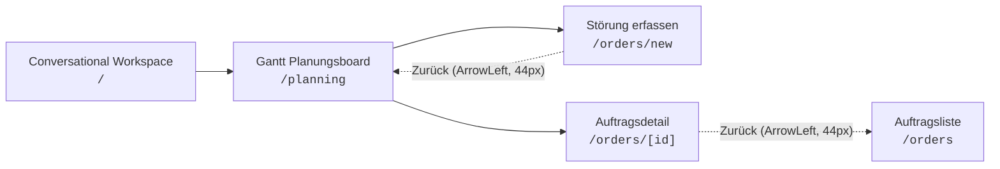

# 📅 6. Grafisches Gantt-Planungsboard & Leitstand

Pfad in der Anwendung: `Operativ > Gantt Planungsboard` (`/planning`)

---

## 1. Ziel & Konzept

Das **Gantt-Planungsboard** ist das zentrale operative Leitstand-Werkzeug für Disponenten, Instandhaltungsleiter und Schichtführer. Es ermöglicht die visuelle Feinplanung, Terminierung und Umverteilung von Instandhaltungsmaßnahmen, Störungsbehebungen und zyklischen Prüfaufträgen auf verfügbare Servicetechniker und Fachgruppen.

---

## 2. Kalender-Navigation & Ansichtsskalierung

### 2.1 Dynamische Ansichtsskalierung
Das Board unterstützt drei umschaltbare Zeithorizonte:
- **Tagesansicht (`day`):** 24-Stunden-Zeitleiste mit 50px pro Stunde, unterteilt in 15-Minuten-Slots für hochpräzise Disposition.
- **Wochenansicht (`week`):** 7 Tage (Montag bis Sonntag) mit 140px pro Tag zur Wochen- und Schichtplanung.
- **Monatsansicht (`month`):** Vollständiger Kalendermonat mit 40px pro Tag und optischer Hervorhebung von Wochenenden für langfristige Revisionen.

### 2.2 Klickbarer Kalender-Header mit nativer Datumsauswahl (`showPicker()`)
- **Arbiträre Datumsauswahl:** Klick auf das zentrale Datumsfeld im Header öffnet unmittelbar den nativen Datums-Dialog des Browsers über die standardisierte HTML5 `showPicker()`-API (mit Fallback auf `focus()`/`click()`).
- **Schnellnavigation:** Über die Pfeil-Buttons (`ChevronLeft` / `ChevronRight`) kann tages-, wochen- oder monatsweise vor- und zurückgesprungen werden.
- **Heute-Schnellsprung:** Ein Klick auf **[Heute]** springt unmittelbar auf das aktuelle Tagesdatum zurück.

---

## 3. Präzisions-Disposition & Interaktion

### 3.1 Striktes 15-Minuten Magnet-Snap-to-Grid
- **Magnetisches Einrasten:** Beim Verschieben per Drag-&-Drop rastet der Auftrag mit Mouse-Offset-Kompensation exakt im 15-Minuten-Raster ein (`SNAP_MINUTES_DAY = 15`).
- **Mathematisch präziser Nenner:** Beginnzeiten richten sich exakt an den Slot-Kanten aus (z. B. 08:00, 08:15, 08:30, 08:45).
- **Entkoppeltes Resizing:** Der rechte Resize-Handle ermöglicht die stufenlose Verlängerung oder Verkürzung der Einsatzdauer, ohne versehentlich einen Drag-Vorgang auszulösen.

### 3.2 Mehrtägige Großmaßnahmen & Langläufer (bis zu 60 Tage)
- **Monatsübergreifende Darstellung:** Großreparaturen, Umbauten und Generalüberholungen mit einer Dauer von bis zu 60 Tagen werden kontinuierlich über Monats- und Wochenwechsel hinweg dargestellt.
- **Pixel-perfektes Day-Snapping:** In der Wochen- und Monatsansicht rasten Start- und Endzeitpunkte nahtlos an den Tagesgrenzen ein.

### 3.3 Unplanned Backlog Inbox Pool
- **Ungeplante Aufträge:** Aufträge ohne Techniker-Zuweisung oder ohne festen Termin werden in der einklappbaren Backlog-Leiste am unteren Bildschirmrand gesammelt.
- **Direktes Einplanen per Drag-&-Drop:** Disponenten ziehen Aufträge direkt aus dem Backlog auf die Zeitleiste des gewünschten Technikers.

### 3.4 Interaktives Detail-Popup-Modal
Ein Klick auf einen Auftragsbalken öffnet das interaktive Detail-Modal:
- **Präzise Zeiteingabe:** Exakte Eingabe von Start- und Endzeit sowie Datum.
- **Techniker-Umdisposition:** Schnelle Zuweisung zu einem anderen Techniker inklusive Qualifikationsprüfung.
- **Materialkonflikt-Warnung:** Visuelle Anzeige bei fehlenden Ersatzteilen (`hasStockConflict`).
- **Direktabsprung:** Über das Symbol `ExternalLink` gelangen Disponenten direkt in die vollständige Auftragsmaske (`/orders/[id]`).

---

## 4. Navigationsstandards & Absprünge

Gemäß den MaintAI Design- & Navigationsrichtlinien gelten für das Planungsboard folgende Standards:

1. **Absprung zu Neuanlage (`+ Neue Störung melden`):**
   - Im Kopfbereich des Planungsboards befindet sich der Button **[+ Neue Störung melden]** (`/orders/new`).
   - Nach Erfassung oder Abbruch führt der standardisierte 44px-Zurück-Button mit Lucide-Icon `ArrowLeft` direkt zurück zum Planungsboard (`/planning`).
2. **Absprung in die Auftragsdetailmaske (`/orders/[id]`):**
   - Aus dem Detail-Modal führt die Schaltfläche **[Vollständigen Auftrag öffnen]** (`ExternalLink`) direkt zu `/orders/[id]`.
   - In der Detailmaske ist links oben der standardisierte `ArrowLeft`-Zurück-Button (mindestens 44px Touch-Höhe) verankert.
